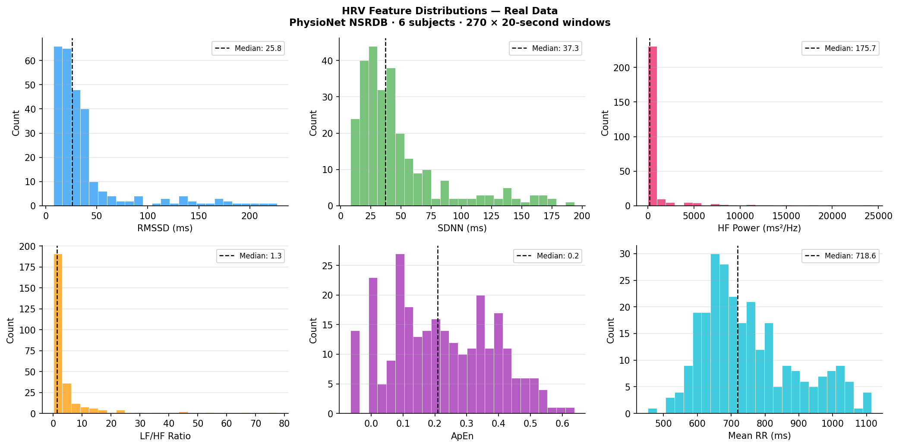
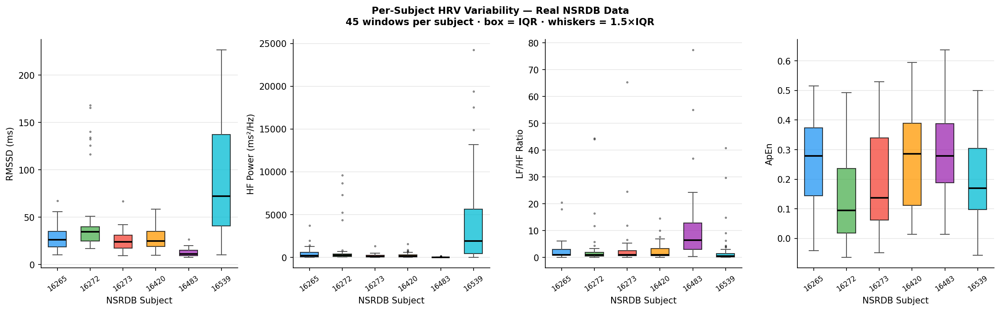
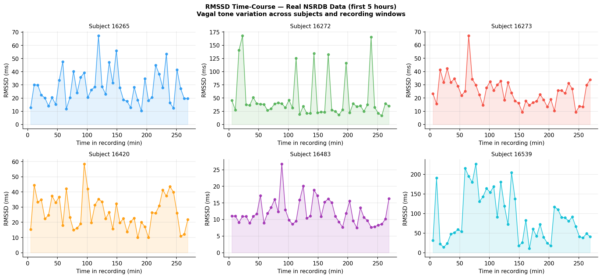
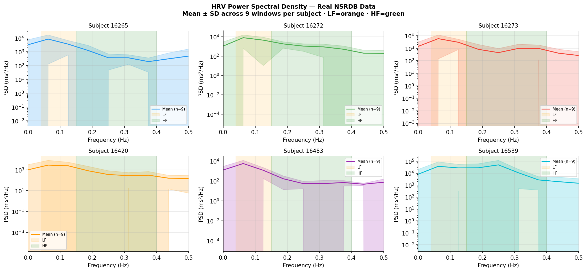

# MMG-HRV Signal Processing Pipeline

A multimodal signal processing and classification pipeline combining **mechanomyography (MMG)** and **heart rate variability (HRV)** to estimate neurophysiological readiness states for adaptive closed-loop functional electrical stimulation (FES).

---

## Background

Most FES rehabilitation systems operate open-loop — stimulation is applied on a fixed schedule regardless of the patient's physiological state. This project builds a pipeline that:

1. Extracts autonomic state from real ECG (PhysioNet NSRDB) using HRV feature analysis
2. Extracts neuromuscular state from MMG using RMS amplitude, mean power frequency, and wavelet energy
3. Classifies the combined signal into one of four **neurophysiological readiness states**
4. Outputs an adaptive FES controller action based on the estimated state

**Why MMG instead of EMG?** EMG is corrupted by FES electrical artefacts. MMG (mechanical vibration of muscle fibres, recorded by accelerometer) is immune to electrical interference — making it the correct choice for real-time feedback during stimulation (Ibitoye et al. 2014).

---

## Readiness states

| State | HRV signature | MMG signature | FES action |
|-------|--------------|---------------|------------|
| High readiness | High RMSSD, high HF power, low LF/HF | High RMS, high MPF | Increase intensity |
| Moderate | Intermediate | Intermediate | Maintain parameters |
| Fatigue / Overload | Low RMSSD, low HF | Low RMS, low MPF | Reduce / pause |
| Low engagement | Low RMSSD, low variability | Low RMS, normal MPF | Arousal protocol |

---

## Results

### HRV Feature Distributions — 270 real NSRDB windows across 6 subjects



### Per-Subject HRV Variability



> Subject 16539 shows median RMSSD ~70 ms versus subject 16483 at ~10 ms — a 7× inter-subject difference in vagal tone among healthy adults. This motivates patient-level normalisation before applying fixed readiness thresholds in clinical FES.

### RMSSD Time-Course (first 5 hours per subject)



### HRV Power Spectral Density — per subject



---

## Data

| Signal | Source | Details |
|--------|--------|---------|
| ECG / HRV | **PhysioNet NSRDB** (real data) | 18 healthy subjects, 128 Hz, downloaded via `wfdb` |
| MMG | Parametric simulation | Based on signal parameters from Hamzaid et al. (2017) *Sensors* 17(7):1627 |

The NSRDB download is automatic on first run and cached locally in `data/nsrdb_cache/`. No account required.

No public FES-MMG dataset exists (clinical data is proprietary), so the MMG model uses physiologically grounded parameters from the published literature. This is the standard approach in the field for pipeline development prior to clinical data collection.

---

## Project structure

```
src/
  hrv_features.py    — ECG cleaning, R-peak detection, HRV feature extraction
  mmg_features.py    — MMG simulation and feature extraction (RMS, MPF, wavelet)
  readiness.py       — Readiness state classifier (rule-based + SVM)
  data_loader.py     — PhysioNet NSRDB downloader with local caching

notebooks/
  01_hrv_analysis.ipynb        — Full HRV pipeline from real ECG
  02_mmg_analysis.ipynb        — MMG feature extraction across four states
  03_multimodal_pipeline.ipynb — Combined classifier, SVM training, FES simulation

results/
  hrv_features_real_nsrdb.csv       — 270 real HRV windows, all features
  hrv_subject_summary_real_nsrdb.csv — per-subject mean ± SD
  figures/                           — all plots
```

---

## Setup

```bash
pip install -r requirements.txt
jupyter lab
```

Open `notebooks/01_hrv_analysis.ipynb` and run all cells. PhysioNet data downloads automatically on first run (~2 MB per segment, cached after that).

To regenerate all result figures and CSVs:

```bash
python generate_results.py
```

---

## HRV features

| Feature | Domain | Physiological meaning |
|---------|--------|-----------------------|
| RMSSD | Time | Root mean square successive differences — primary vagal tone index |
| SDNN | Time | Overall HRV magnitude |
| pNN50 | Time | % successive differences > 50 ms |
| HF power | Frequency | Parasympathetic (vagal) activity, 0.15–0.40 Hz |
| LF/HF ratio | Frequency | Sympathovagal balance |
| ApEn | Nonlinear | Signal complexity — decreases with fatigue |

## MMG features

| Feature | Physiological meaning |
|---------|----------------------|
| RMS amplitude | Global muscle activation; declines with fatigue |
| Mean Power Frequency | Shifts downward with fatigue (slow-twitch fibre recruitment) |
| Wavelet energy (db4) | Per-band energy distribution — captures amplitude + frequency changes |

---

## References

- Hamzaid N.A. et al. (2017). MMG and torque during FES-evoked contractions to fatigue in SCI. *Sensors*, 17(7):1627.
- Ibitoye M.O. et al. (2014). Mechanomyography and muscle function assessment: a review. *Clinical Biomechanics*, 29(6):691–704.
- Shaffer F. & Ginsberg J.P. (2017). An overview of HRV metrics and norms. *Frontiers in Public Health*.
- Hamzaid N.A. & Naeem J. (2026). Function and fatigue monitoring in neuromuscular electrically-evoked exercise after SCI. *Expert Review of Medical Devices*.
- PhysioNet NSRDB: physionet.org/content/nsrdb/1.0.0/
